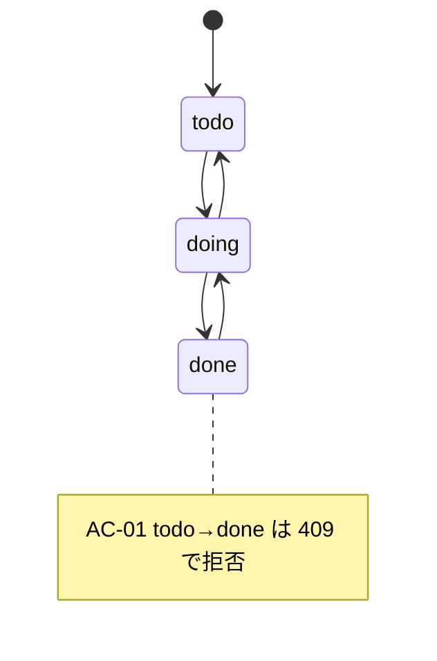
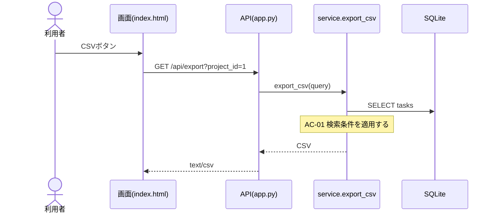

# UML図の作成ガイド（全スキル共通）
GitHub上でそのまま表示できる Mermaid で書く。画像ファイルは作らない。

## 作るかどうかの判断（必要なときだけ）
| 状況 | 図 | 例 |
|---|---|---|
| 状態・ステータスが変わる | stateDiagram-v2 | タスクの todo→doing→done |
| 画面→API→DBなど複数層をまたぐ処理 | sequenceDiagram | 検索、CSV出力、更新競合 |
| テーブル・クラスの追加/変更 | erDiagram / classDiagram | 列追加、関連追加 |
| 分岐の多い業務ルール | flowchart | 入力チェック、権限判定 |
| 変更が1関数内で完結、文言修正、設定値変更 | 作らない | 「図: 不要（理由）」と1行書く |

## ルール
- 1図あたり要素15個以内。全体図ではなく**今回の変更範囲だけ**を描く
- 図の要素名はコードの実名（関数名・テーブル名・状態値）に合わせる。存在しない要素を描かない
- 不具合では「現状（誤り）」と「あるべき姿」を並べ、違いを `%% 変更点` コメントか note で示す
- 受入基準（AC-xx）と対応する箇所には note で AC番号を付ける
- 未確認の部分は描かず、「未確認」と本文に書く
- 書いたら構文を確認する: `python tools/check-mermaid.py <ファイル>`

## 例: 状態遷移（不具合の現状とあるべき姿）

## 例: シーケンス

